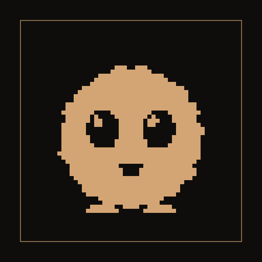

<p align="center"></p>

<h1 align="center">Nookling</h1>

<p align="center"><em>A small round friend, kept in a warm corner of your phone.</em></p>

<p align="center">
  Android&nbsp;·&nbsp;<a href="https://github.com/not-mehul/Nookling/releases/latest">Latest release</a>&nbsp;·&nbsp;MIT&nbsp;·&nbsp;Created by <strong>Mehul Sen</strong>
</p>

---

Nookling is a virtual pet for Android: a perfectly round ball of fluff with enormous eyes and a tiny smile that lives in a lamp-lit nook. Feed it, play with it, keep it tidy and put it to bed. It keeps living while the app is closed, its needs falling on a steady clock, and it can remind you when it would like some company. It never dies and never guilt-trips: a neglected nookling just feels unwell until you come back.

> Version 0.1.0, ready for its first Android release. Still to come: a home-screen widget, shake-to-wobble, a seven-day chart of its needs, and links to and from the other apps.

## Features

### Your nookling

- **One original creature**, drawn in the suite's style from shared colour tokens, so it looks at home in Dusk and in Dawn.
- **Four needs**: Fullness, Energy, Mood and Tidiness, each shown as a word as well as a bar. Health and the bond between you show in how it looks.
- **It grows up.** A seedpod hatches in the first session, becomes a sprout, then a full nookling, then one of four grown forms chosen by how it was cared for.
- **It sleeps when you do**, from the bedtime and wake time you set.

### Care and play

- **Touch it.** Tap to boop, stroke to soothe, tickle, hold for a cuddle, drag food to its mouth, scrub it clean. Every gesture also has a button.
- **The Pantry**: a dozen foods with their own effects. No currency, no shop, no purchases.
- **Three short games**: Catch, Hide and seek, and Echo.
- **The Journal**: a care log, milestones and a photo album of your nookling.

### While you are away

- **Time keeps passing.** Its needs are replayed from where they were, every time you open the app.
- **Reminders**, scheduled ahead of time, never during quiet hours, and at most three a day.
- **Away mode** leaves it with a sitter for up to two weeks; **Gentle mode** halves every rate.

### Your data

- **Backups** as one zip, and **Dusk and Dawn themes**.
- **A little delight**: soft chirps, celebrations for real milestones, and easter eggs, counted in Settings. All of it respects reduced motion.

## Private by design

The pet lives on the phone. Nookling has no account and no server, and it doesn't even ask for network access.

## Install

Download the signed APK from the [latest release](https://github.com/not-mehul/Nookling/releases/latest) and open it on your phone. The same app also runs in a browser for trying it out.

## The Dusk & Dawn apps

Nookling is one of seven apps by Mehul Sen that share one design system, [Editorial Dusk & Dawn](https://github.com/not-mehul/dusk-dawn), and a common link scheme, so they can hand things to each other.

| App | What it is for |
|---|---|
| [Waymark](https://github.com/not-mehul/Waymark) | Your whole trip, offline: flights, stays, plans and costs on one timeline |
| [BookShelf](https://github.com/not-mehul/BookShelf) | Books, films, shows and the lines worth keeping |
| [Ledger](https://github.com/not-mehul/Ledger) | A record of cities, scored on what matters to you |
| [Colophon](https://github.com/not-mehul/Colophon) | Inspect, fix and rebind EPUB editions |
| [Rosetta](https://github.com/not-mehul/Rosetta) | A quiet library and reader for books, papers and notes |
| [Mise](https://github.com/not-mehul/Mise) | Recipes from anywhere, cooked one step at a time |
| [Nookling](https://github.com/not-mehul/Nookling) | A small round friend to feed, play with and put to bed |

## Build from source

Svelte 5 and TypeScript, built by Vite, with Dexie for storage, in a Capacitor 8 Android app. You need Node 22.12 or later, plus JDK 21 and Android Studio for the app.

```sh
npm install
npm run dev          # http://localhost:5173
npm run check        # contrast, lint, literal colours, typecheck, unit tests
npm run android      # build, sync and open Android Studio
```

[docs/DEVELOPMENT.md](docs/DEVELOPMENT.md) covers the scripts, the project layout, how time passes for the pet, and the phases. [RELEASING.md](RELEASING.md) covers signing and releases.

## Credits

Nookling is designed and built by **Mehul Sen** ([@not-mehul](https://github.com/not-mehul)).

- Libraries: Dexie (Apache 2.0), fflate (MIT), Capacitor (MIT) and [Lucide](https://lucide.dev) icons (ISC).
- Fonts and design: Fraunces (SIL Open Font License) through [dusk-dawn](https://github.com/not-mehul/dusk-dawn).
- The nookling, its food and its sounds are original to this app.

## Licence

[MIT](LICENSE) © 2026 Mehul Sen.
