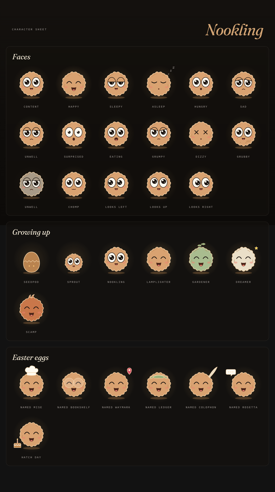

# Developing Nookling

Nookling is built like its siblings, and Mise in particular: Svelte 5 and TypeScript, Vite, Dexie over IndexedDB, Capacitor 8 for Android, and the shared design package [`dusk-dawn`](https://github.com/not-mehul/dusk-dawn). Everything visual comes from that package; this repository only places it.

## Scripts

| Script | What it does |
|---|---|
| `npm run dev` | The app in a browser at http://localhost:5173 |
| `npm run check` | Contrast (`dusk-dawn check`), ESLint, no literal colours (`dusk-dawn colours`), `svelte-check`, Vitest |
| `npm run test:e2e` | A production build, then the Playwright tests at phone size, with axe in both themes |
| `npm run sheet` | Renders the pet's character sheet (`sheet.html`) in both themes to `docs/character-sheet-*.png` |
| `npm run icons` | Renders every launcher icon from `assets/icon-source.svg` |
| `npm run sync` / `android` | Build and copy into the Android project / and open Android Studio |

If Playwright can't find its browser, point it at one with `PLAYWRIGHT_CHROMIUM_PATH`.

## Layout

| Path | What lives there |
|---|---|
| `src/domain/` | Plain, tested logic with no Svelte or browser APIs: settings and, later, the needs simulation |
| `src/data/` | The Dexie database |
| `src/state/` | Reactive state (`*.svelte.ts`) the components read |
| `src/platform/` | Capacitor and browser edges: theme, links between the apps, files, notifications |
| `src/pet/` | The nookling's drawing and behaviour |
| `src/components/` | Screens and their parts; `ui/` holds small shared pieces |
| `src/i18n/` | Strings. English first, in Mise's structure so more languages can follow |

## The pet

`src/pet/Pet.svelte` is the whole creature: one inline SVG rig (fluff, eyes, pupils, lids, mouth, cheeks, glow) whose colours are all dusk-dawn `--pet-*` tokens, so it follows the theme with no redraw. Its shapes come from `src/pet/geometry.ts`. It takes a stage, a form, an expression, where it looks, its glow, how grubby it is and whether it is unwell, and `react()` plays one-off movements (hop, squish, wiggle and the rest) on the Web Animations API.

It breathes and blinks only while it is on screen and the page is visible, and holds still under reduced motion (style.md §11.2, the living-subject rule).

## Links between the apps

`src/platform/links.ts` is the suite's shared file (style.md §14.1), with `nookling` added to `APPS`. Nookling answers `nookling://open`, which only brings it to the front. The other six apps add `nookling` to their copy of `links.ts` and their `<queries>` when the first hand-off to Nookling is built.

## Phases

The app was built in phases, each one committed and working on its own. All ten are done:

1. dusk-dawn 2.2.0: pet tokens, the need meter and the living-subject rule
2. Scaffold: this repository, CI, release, icon
3. The pet: its SVG rig, expressions and forms, and a character sheet
4. The simulation and the database
5. The Nook: the live pet, meters and care actions
6. Touch, the Pantry, haptics and chirps
7. Reminders
8. Growing up: hatching, stages, traits and forms
9. Journal, Play and backups
10. Easter eggs, then v0.1.0

### Easter eggs

Four, counted in Settings → About (`src/lib/delight.ts`, rules in `src/domain/delights.ts`):

- **The Konami code** (↑ ↑ ↓ ↓ ← → ← → B A): a somersault and sparks.
- **Seven taps on the title**: the fluff tickles its nose. Achoo.
- **A sibling's name**: name it Mise, BookShelf, Waymark, Ledger, Colophon or Rosetta and it wears that app's prop.
- **Its hatch day**, a year or more on: a cake.

Not an egg, but a milestone: its first whole day with every need at half or more gets confetti and a line in the Journal.

### After v0.1.0

- A home-screen widget, shake-to-wobble and a seven-day chart of its needs.
- Cross-app links, once the first release is out: the other six apps gain `nookling` in their `links.ts`.
- Switch the dusk-dawn pin from a commit to the `v2.2.0` tag once that tag exists.
