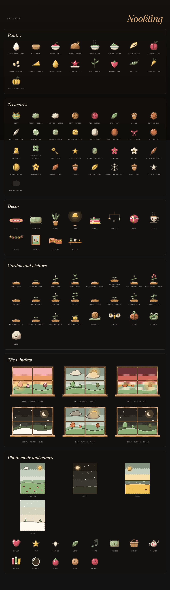

# Developing Nookling

Nookling is built like its siblings, and Mise in particular: Svelte 5 and TypeScript, Vite, Dexie over IndexedDB, Capacitor 8 for Android, and the shared design package [`dusk-dawn`](https://github.com/not-mehul/dusk-dawn). Everything visual comes from that package; this repository only places it.

## Scripts

| Script | What it does |
|---|---|
| `npm run dev` | The app in a browser at http://localhost:5173 |
| `npm run check` | Contrast (`dusk-dawn check`), ESLint, no literal colours (`dusk-dawn colours`), `svelte-check`, Vitest |
| `npm run test:e2e` | A production build, then the Playwright tests at phone size, with axe in both themes |
| `npm run sheet` | Renders the pet's character sheet (`sheet.html`) and the art sheet (`art.html`) in both themes to `docs/character-sheet-*.png` and `docs/art-sheet-*.png` |
| `npm run icons` | Renders every launcher icon from `assets/icon-source.svg` (redraw that, and `public/favicon.svg`, with `node scripts/pixel-mark.mjs`) |
| `npm run sync` / `android` | Build and copy into the Android project / and open Android Studio |

If Playwright can't find its browser, point it at one with `PLAYWRIGHT_CHROMIUM_PATH`.

## Layout

| Path | What lives there |
|---|---|
| `src/domain/` | Plain, tested logic with no Svelte or browser APIs: settings, the needs simulation (cozy and Tamagotchi), foods and games |
| `src/data/` | The Dexie database |
| `src/state/` | Reactive state (`*.svelte.ts`) the components read |
| `src/platform/` | Capacitor and browser edges: theme, links between the apps, files, notifications |
| `src/pet/` | The nookling's drawing (and its clothes) and behaviour |
| `src/world/` | Everything beyond its needs, as plain tested functions: finds and treasures, moments, the arcade's record, tricks, chat, decorations, the garden, the wardrobe, weather, stories, visitors and dishes and books from the other apps. One `World` row in Dexie, kept by `src/state/world.svelte.ts` |
| `src/components/` | Screens and their parts; `ui/` holds small shared pieces |
| `src/i18n/` | Strings. English first, in Mise's structure so more languages can follow |

## The pet

`src/pet/Pet.svelte` is the whole creature, drawn as high-resolution pixel art: a 96 × 96 sprite (`src/pet/sprite.ts`) whose colours are all dusk-dawn tokens, so it follows the theme with no redraw. Its shapes come from `src/pet/geometry.ts`; pupils step in whole pixels, a blink redraws the eyes shut, and the breath steps rather than glides. It takes a stage, a form, an expression, where it looks, its glow, how grubby it is and whether it is unwell, and `react()` plays one-off movements (hop, squish, wiggle and the rest) on the Web Animations API.

It breathes and blinks only while it is on screen and the page is visible, and holds still under reduced motion (style.md §11.2, the living-subject rule).

## Pixel art

Every picture in the app (the pet, its clothes, foods, treasures, decor, the garden, visitors, the window, photo backdrops and stickers, and the games) is pixel art from one renderer, `src/pixel/raster.ts`. A drawing is a list of layers of simple shapes (SVG path data, ellipses, rects, strokes) in token colours, described with the helpers in `src/pixel/kit.ts`. The renderer samples them onto a grid of square pixels and finishes them the way a pixel artist would: a dark selective outline, shade on the side away from the light (top left), a highlight, and checkerboard dither between tones. Shades and highlights are `color-mix()` of the layer's token with another token, so nothing is a literal colour. Out comes one SVG path per colour, drawn with crisp edges (`src/pixel/Pixels.svelte`, `PixelIcon.svelte`), cached by description.

The art itself lives beside what it draws: `src/pet/sprite.ts` and `clothes.ts`, and `src/world/art/*-art.ts`. `art.html` shows every piece on one page.

## Links between the apps

`src/platform/links.ts` is the suite's shared file (style.md §14.1), identical in all seven apps. Nookling answers:

- `nookling://open`, which only brings it to the front;
- `nookling://cooked?dish=…` from Mise, and `nookling://read?title=…&author=…` from BookShelf. Each opens the Nook with a card; the dish joins the Pantry, or the book the pet's bookshelf, only after a yes (`src/platform/incoming.ts`, `src/world/siblings.ts`).

Mise and BookShelf send these with `@capacitor/app-launcher`, only when Nookling is installed.

## The home-screen widget

`android/.../NooklingWidget.java` draws the pet, its name and its status line from what the page last sent through `WidgetPlugin.java` (`src/platform/widget.ts`), each time the app is put away. It never refreshes on a timer and runs nothing in the background.

## Cozy and Tamagotchi

`Settings.style` picks the rules. Cozy (the default) keeps every need above `COZY_FLOOR`, never lowers health, makes a mess only every third meal and tidies up on waking; it sends invitations (good news about a find) rather than reminders, and the Nook shows the day's moments (`TodayPanel.svelte`) instead of meters. Tamagotchi is the classic v0.1 behaviour.

## Phases

The app was built in phases, each one committed and working on its own. All ten are done:

1. dusk-dawn 2.2.0: pet tokens, the need meter and the living-subject rule
2. Scaffold: this repository, CI, release, icon
3. The pet: its SVG rig, expressions and forms, and a character sheet
4. The simulation and the database
5. The Nook: the live pet, meters and care actions
6. Touch, the Pantry, haptics and chirps
7. Reminders
8. Growing up: hatching, stages, traits and forms
9. Journal, Play and backups
10. Easter eggs, then v0.1.0

### Easter eggs

Four, counted in Settings → About (`src/lib/delight.ts`, rules in `src/domain/delights.ts`):

- **The Konami code** (↑ ↑ ↓ ↓ ← → ← → B A): a somersault and sparks.
- **Seven taps on the title**: the fluff tickles its nose. Achoo.
- **A sibling's name**: name it Mise, BookShelf, Waymark, Ledger, Colophon or Rosetta and it wears that app's prop.
- **Its hatch day**, a year or more on: a cake.

Not an egg, but a milestone: its first whole day with every need at half or more gets confetti and a line in the Journal.

### After v0.1.0: an idle companion, never a chore

- **v0.2, the cozy update**: cozy mode, invitations, foraging and the Treasures book, little moments, gifts in the welcome-back.
- **v0.3, the arcade**: six more games, the game of the day, fidget, shake-to-wobble, tricks and chat.
- **v0.4, make it yours**: decorating the nook, the garden and the wardrobe.
- **v0.5, calm and seasons**: quiet time (window, weather, sound, breathing, bedtime stories), visitors, seasons, photo mode and the home-screen widget; dishes from Mise and books from BookShelf.
